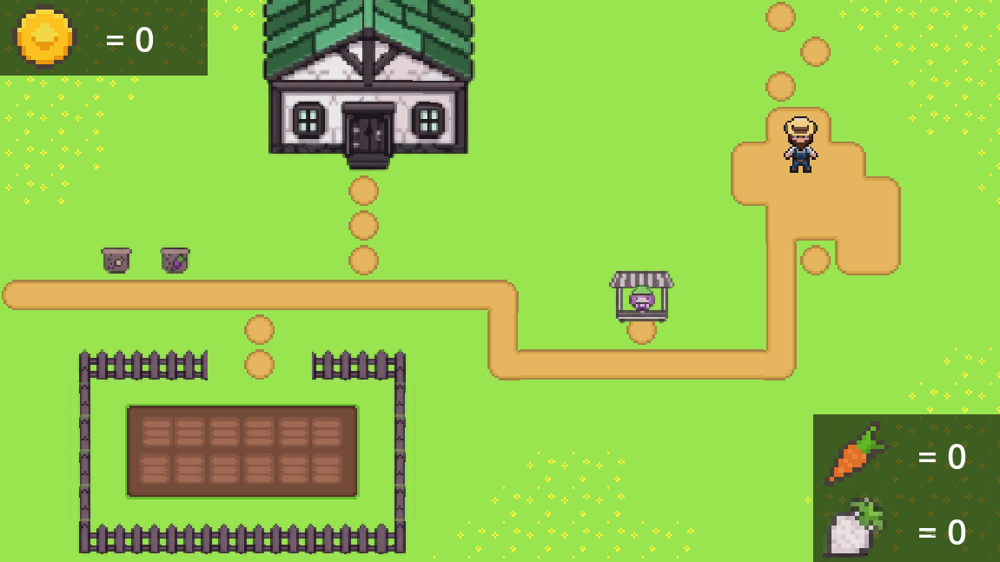

<h1 align="center">🌾 Harvest Valley Game</h1>

<p align="center">
  <b>A 2D RPG farming game made with Godot 4.</b>
</p>

<div align="center">
  
  <br><br>
  <a href="#"></a>
  <a href="#"></a>
  <a href="#"></a>
</div>

<br>

## 📖 The Story

Welcome to Harvest Valley! You've just inherited a small plot of land and a dream. Your goal is simple: plant seeds, water your crops, harvest them, and sell them at the local market. 

Work hard, manage your time, and see if you can turn a profit. Can you reach your goal of 100 coins and make the valley prosperous again?

<br>

## 🎮 Controls

<div align="center">

| Action | Key / Input |
| :--- | :--- |
| **Move** | <kbd>W</kbd> <kbd>A</kbd> <kbd>S</kbd> <kbd>D</kbd> or <kbd>↑</kbd> <kbd>↓</kbd> <kbd>←</kbd> <kbd>→</kbd> |
| **Select Carrot Seeds** | <kbd>1</kbd> |
| **Select Onion Seeds** | <kbd>2</kbd> |
| **Plant Seeds** | *See Input Map (e.g., Space / E)* |
| **Water Crops** | *See Input Map (e.g., Space / E)* |
| **Harvest Crops** | *See Input Map (e.g., Space / E)* |
| **Sell Crops** | <kbd>G</kbd> *(Must be near the Shop)* |

</div>

<br>

## 🏆 How to Beat the Game (Walkthrough)

> *Your goal is to reach **100 Coins**.*

1. **Gather Seeds:** Walk around the map to find seed packs. Walk over them to pick them up (you will get Carrot or Onion seeds).
2. **Select Your Crop:** Press <kbd>1</kbd> to equip Carrot Seeds, or <kbd>2</kbd> to equip Onion Seeds.
3. **Plant & Water:** Walk to a dirt growing zone. Use your interact keys to **Plant** the seed, and then **Water** it. Your character will play an animation.
4. **Wait for Growth:** Once watered, the crop will begin growing. Give it some time!
5. **Harvest:** Once the plant is fully grown, interact with it again to **Harvest** it. It will be added to your inventory.
6. **Sell at the Shop:** Walk to the Shop Stall. Stand near it and press <kbd>G</kbd> to sell all your harvested crops for **10 coins each**.
7. **Win:** Keep farming until you reach 100 Coins. Once you hit 100, the win screen will trigger!

<br>

## 🛠️ How to Run the Project in Godot

If you want to open this project in the Godot Engine and look at the code:

1. Download and install **[Godot Engine (v4.x)](https://godotengine.org/download)**. *(Standard version, no C# needed)*.
2. Clone this repository to your computer:
   ```bash
   git clone https://github.com/KenjiLao-20/Harvest-Valley-Game.git
   ```
3. Open the **Godot Project Manager**.
4. Click the **Import** button.
5. Click **Browse** and navigate to the folder where you cloned the repository. Select the `project.godot` file.
6. Click **Import & Edit**.
7. Once the editor opens, press <kbd>F5</kbd> (or click the Play button in the top right) to run the game!

<br>

## 📂 Project Structure

* 📁 `Scenes/` - Contains all the game scenes (`world.tscn`, `win_screen.tscn`, `floating_text.tscn`, etc.).
* 📁 `Scripts/` - Contains the core gameplay logic (`character_body_2d.gd`, `growingzone.gd`, `shop_stall.gd`, etc.).
* 📄 `global.gd` - The Autoload singleton that tracks the player's coins, seeds, and harvested crops across scenes.

<br>

---
<div align="center">
  <i>Made with ❤️ using Godot Engine.</i>
  <br><br>
  <small><b>Developer Secret:</b> Press <kbd>P</kbd> while playing to instantly cheat and get 100 coins for testing! 🤫</small>
</div>
